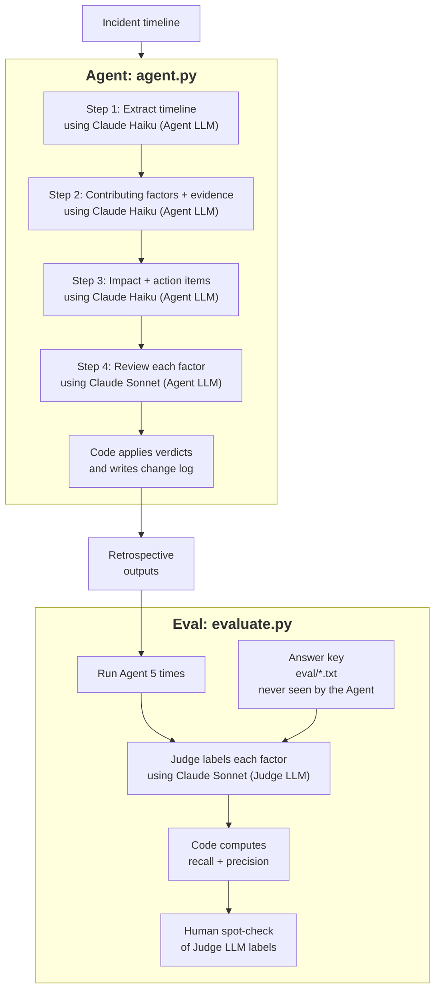

# Incident Retrospective Agent

An AI agent that reads a published outage timeline and drafts a structured retrospective: timeline, contributing factors with evidence, impact, and action items. An automated eval scores its contributing factors against answer keys built from each company's own root cause analysis.

Tested on 5 real outages, including CrowdStrike 2024 and AWS us-east-1 2025.

## Results

Contributing factors, mean of 5 runs per incident.

| Incident | Recall | Precision |
|---|---|---|
| GitLab database outage, 2017 | 100% | 100% |
| AWS S3 us-east-1, 2017 | 96% | 100% |
| Google Cloud Service Control, 2025 | 100% | 100% |
| AWS DynamoDB us-east-1, 2025 | 97% | 100% |
| CrowdStrike Channel File 291, 2024 | 92% | 100% |

Recall: share of the published contributing factors the agent found.

Precision: share of the agent's factors that were correct (matched the key or were supported by the input).

## Workflow



**Guardrails:** Every step's output is checked in code. Invalid JSON is retried once; a reply cut off by the token limit fails fast.

## How the agent works

| Step | What it does | Model |
|---|---|---|
| 1. Timeline | • Reads the raw incident text and lists every event as structured JSON: time and what happened<br>• Code checks that the JSON is valid and every event has the required fields<br>• Limit: 8,000 tokens, raised after the long DynamoDB input was cut off<br>• Saved as `step1.json` | Claude Haiku |
| 2. Contributing factors | • Uses the timeline and the original text to identify what contributed to the outage<br>• Each factor must quote evidence from the input, so every claim can be traced back to the source<br>• Code checks the structure: each factor has both a factor and evidence<br>• Saved as `step2.json` | Claude Haiku |
| 3. Impact and actions | • Writes a short impact summary<br>• Proposes action items, each with an action, an owner role (a team or role, never a person's name, in line with blameless practice), a type (prevent, detect or mitigate) and a priority (high, medium or low)<br>• Code checks that every field is filled in, and that type and priority use the allowed values<br>• Saved as `step3.json` | Claude Haiku |
| 4. Review | • Reviews the draft against the input only; never sees the answer key<br>• Gives a verdict on each numbered factor: keep, remove, or merge into another factor, with a reason and optional rewording<br>• Also reviews the action items: removes ones that don't address any factor, makes vague ones specific, and fixes owner roles that point at one person<br>• Code checks the verdicts: exactly one per factor, and a merge must point to a factor that is kept, so merges can't chain<br>• Code, not the model, applies the verdicts and writes the change log, so the log always matches what actually changed<br>• Limit: 4,000 tokens<br>• Saved as `step4.json`, the final retrospective | Claude Sonnet |

## How it is evaluated

- **Input and answer key are separate.** For each incident, the agent gets only what happened. The company's analysis and remediation list go into an answer key the agent never sees.
- **5 runs per incident**, because output varies from run to run.
- **LLM-as-judge.** Claude Sonnet labels each factor: match (to one or more answer-key lines), valid extra, duplicate, or wrong. Recall and precision are computed in code, not by the judge.
- **The judge was tested too.** On GitLab, I planted 5 known-bad factors; it caught all 5 in all 3 runs (15/15).

## What I learned

- **The judge was lenient in ways the prompt could not fix.** It accepted a factor that named a snapshot as a cause of data loss, when that snapshot is what limited the loss. Adding an explicit rule to the judge prompt did not change this. It caught 15/15 planted errors but missed this real one, so planted tests overstated how reliable it was.
- **Two apparent agent weaknesses were scoring artifacts.** The agent often combined two causes in one factor, and the judge could credit only one answer-key line per factor. I read the agent's actual output before trusting a low score, then let the judge match one factor to several lines.
- **Reflection with the same small model did nothing.** Haiku reviewing Haiku kept 12 of 12 factors and logged changes it never made. Switching the review step to Sonnet, and having code apply per-factor verdicts, fixed both.
- **A strict evidence check also removes good inferences.** The reviewer removed "Service Control should fail open", which is Google's own main lesson, because the input never said it.
- **Token limits sized for short inputs do not scale.** The DynamoDB input was about 3 times longer than GitLab's and cut Step 1 off in 4 of 5 runs. Retrying at the same limit wasted calls, so truncation now fails fast with its own error.
- **On CrowdStrike, the agent in some runs named the kernel-mode driver** as the reason a content bug crashed whole machines, a factor CrowdStrike's own findings did not list.
- **I kept answer keys fixed after seeing results.** Where the agent missed a factor, I did not edit the key to raise the score.

## Limitations

- 5 incidents is a small sample.
- These outages are well known, so the models may have seen the postmortems in training.
- I wrote the answer keys from each company's published analysis; they reflect my reading of it.
- Precision was 100% on every incident, so it does not separate good runs from weaker ones.
- Only contributing factors are scored, not action items.

## Run it

Requires Python 3.12 and an Anthropic API key.

```
python -m venv venv
source venv/bin/activate
pip install -r requirements.txt
echo "ANTHROPIC_API_KEY=your-key" > .env
```

```
# Run the agent once
python agent.py data/gitlab_timeline.txt

# Run 5 times and score against the answer key
python evaluate.py data/gitlab_timeline.txt eval/gitlab_answer_key.txt

# Re-score saved runs without re-running the agent
python evaluate.py data/gitlab_timeline.txt eval/gitlab_answer_key.txt --rescore

# Test the judge with planted wrong factors
python evaluate.py data/gitlab_timeline.txt eval/gitlab_answer_key.txt --judge-test
```

## Repository

| Path | Contents |
|---|---|
| `agent.py` | The 4-step agent |
| `evaluate.py` | Eval runner and LLM judge |
| `data/` | Agent inputs: incident timelines |
| `eval/` | Answer keys |
| `outputs/` | Each run's step outputs and `scores.json` |
| `BUILD_LOG.md` | Build notes in order, including what went wrong |
| `requirements.txt` | Python packages needed to run it |

## Sources

- [GitLab database outage, January 31, 2017](https://about.gitlab.com/blog/postmortem-of-database-outage-of-january-31/)
- [AWS S3 service disruption, February 28, 2017](https://aws.amazon.com/message/41926)
- [Google Cloud incident report, June 12, 2025](https://status.cloud.google.com/incidents/ow5i3PPK96RduMcb1SsW)
- [AWS DynamoDB service disruption, October 19-20, 2025](https://aws.amazon.com/message/101925)
- [CrowdStrike Channel File 291 root cause analysis](https://crowdstrike.com/wp-content/uploads/2024/08/Channel-File-291-Incident-Root-Cause-Analysis-08.06.2024.pdf)

Built with Claude Code as the coding assistant. I designed the agent and eval, reviewed every change, graded the first run by hand, and spot-checked the Judge LLM's labels on all 5 incidents.
